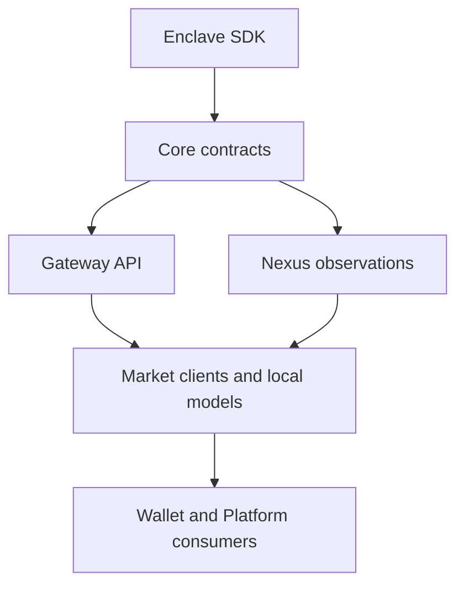

# Conxian Market SDK (`@conxian/market-sdk`)

> **Client contracts, local planning and commerce integration for autonomous agents**
> **Source version:** 0.2.4 | **Qualification:** operation-specific provider and release evidence required

---

## 🏛 Ecosystem Role & Boundary Alignment

The `conxian_market` repository (`@conxian/market-sdk`) supplies commerce calculations, local escrow bookkeeping, SDK clients and onboarding plans. Bitcoin L1 is the trust root for universal-chain integration; there is no native Conxian token. Code interfaces and registry entries are separate from live connections and production qualification.

The market-agnostic, non-custodial architecture includes:

- **Attestation client interfaces**: backend-dependent certificate checks; local hashes remain unsigned correlation records.
- **Escrow models (ERC-8183 / CJCS Job Cards)**: local state and budget calculations; real locks and finality require an independently verified provider.
- **Multi-rail client contracts**: Lightning, Fedimint, sBTC, ALEX, Citrea, RGB and EVM integrations each retain their own operation gates.
- **SLA calculations**: job evaluation, penalty and reputation rules; local evaluation does not establish real enforcement or dispute settlement.
- **Agent interfaces**: offline CLI discovery/preview, bounded authenticated registration diagnostics, and an explicit x402 v2 wire profile.



Arrows describe source dependencies or client contracts. They do not prove a live deployment or qualified operation; Market mirrors Core types rather than loading Rust directly.

---

## 🔗 Dependency and Integration Coverage

The Marketplace SDK is intentionally designed to consume the Conxian org stack at the correct abstraction layer:

| Dependency | Status in this Repo | Evidence / Module | Notes |
|:-----------|:-------------------|:------------------|:------|
| **Conxian/Conxian** | **Deprecated / Archived Reference** | [src/market_agnostic_router.ts](src/market_agnostic_router.ts) | Custom smart contract development is frozen to eliminate maintenance debt and audit overhead in favor of external BYO DeFi adapters. |
| **lib-conxian-core** | **Type alignment** | [src/core_types.ts](src/core_types.ts) | TypeScript mirrors of trust-tier, chain, rail and settlement definitions; no Rust library is loaded here. |
| **conxian-gateway** | **HTTP client contract** | [src/gateway_client.ts](src/gateway_client.ts) & [src/settlement.ts](src/settlement.ts) | Actual endpoint, authorization, operation evidence and deployment must be verified separately. |
| **conxian-nexus** | **Registration diagnostic contract** | [src/provider_discovery.ts](src/provider_discovery.ts) | Read-only registrations; no qualified operation or provider health inferred. |
| **conxius-enclave-sdk** | **External security boundary** | [src/verification.ts](src/verification.ts) & [src/x402_facade.ts](src/x402_facade.ts) | Cryptographic/provider verification belongs to qualified services; this JavaScript package does not load the Rust SDK. |
| **conxius-platform** | **Control Plane** | Org docs & roadmap | CI/CD automation and release rulesets. |
| **conxian-business** | **Governance Boundary** | [src/bos_yield_splitter.ts](src/bos_yield_splitter.ts) | Commercial packaging doctrine (80/10/10 split, fee decay, founder vesting). |

---

## 🛠 SDK Interface Catalog

The following catalog describes source interfaces. It is not a count of qualified operations or live providers:

1. **Control Model (`verification.ts`)**: TrustTier detection & P0 gap degradation.
2. **CJCS Escrow (`gateway_client.ts`)**: Programmable Job Card settlement & escrow.
3. **Attestation Verifier (`verification.ts`)**: TEE (Nitro/KeyMint) & ZK proof validation via Nexus/Gateway.
4. **Fee Calculator & Revenue Model (`fee_calculator.ts`)**: Tier-based pricing, discounts & revenue projections.
5. **Settlement Orchestration (`settlement.ts`)**: Multi-rail settlement execution across 8+ rails.
6. **Autonomous SLA Engine (`sla_engine.ts`)**: Automated job card evaluation, delay penalties, gap cards & builder reputation.
7. **Telemetry & Treasury Watcher (`monitoring_watcher.ts`)**: sBTC peg health, Fedimint mints, Babylon staking & 12-month runway calculator.
8. **TrustTier Middleware (`trust_tier_middleware.ts`)**: 4-stage pricing pipeline, SLA template resolution & wire headers.
9. **BOS Yield Splitter (`bos_yield_splitter.ts`)**: 80/10/10 yield split, fee decay timeline, founder vesting & Thin Orchestrator BYOK guard.
10. **Market-Agnostic Router (`market_agnostic_router.ts`)**: Zero-custody validation, BYO DeFi protocol adapter resolution, M2M MCP routing & deprecation advisory.
11. **Job Card Escrow Engine (`job_card_escrow.ts`)**: in-memory escrow creation, submission, release, dispute/refund and reconciliation models.
12. **Legacy payment facade (`x402_facade.ts`)**: sats/payment-pointer correlation and attestation client calls; local hashes and bookkeeping are not payment or locked-funds evidence.
13. **Client Installation Engine (`client_onboarding.ts`)**: configuration validation and local plans; provisioning remains incomplete without independent evidence.
14. **Provider Discovery (`provider_discovery.ts`)**: bounded read-only Gateway/Nexus registration contracts.
15. **x402 v2 Wire Profile (`x402_v2_wire.ts`)**: explicit HTTP/MCP codecs and structural schemas; payment and signature verification are separate.

---

## 📊 Economic & Governance Framework

- **Yield Matrix (80/10/10)**: 80% Builder, 10% Platform Treasury, 10% Ecosystem Stakeholders.
- **Protocol Fee Structure**: 2.0% launch rate (50% Operations, 30% Founder Vesting, 20% Ecosystem Growth).
- **Fee Decay Timeline**: 2.0% (0–12m), 1.5% (12–36m), 1.0% (36m+).
- **Zero-Custody Mandate**: Conxian never touches or custodies client funds or private data.
- **Thin Orchestrator & BYOK**: Centralized heavy AI inference is prohibited; compute runs at the edge or via user-provided keys.

---

## ⚡ Quick Start (x402 v2 Wire Profile)

```typescript
import { decodeX402V2Header } from "@conxian/market-sdk";

// Source API: use a build containing this change until its package release is published.
function inspectRequiredHeader(header: string) {
  const demand = decodeX402V2Header("required", header);
  // Inspect these values under the caller's policy.
  // Parsing does not verify payment, execute a tool, lock escrow or grant entitlement.
  return { resource: demand.resource, accepts: demand.accepts };
}
```

---

## 🚀 Indie Agent Quickstart & Onboarding CLI

Copy-pasteable integration for ElizaOS, LangGraph, AutoGen, and CrewAI builders:

```bash
# Inspect the local plan without creating keys, files or network requests
conxian-agent-init --dry-run --json

# Explicit diagnostic read with a separately configured authorized HTTPS target
conxian-agent-init --diagnose gateway --endpoint https://gateway.example.invalid --token-env CONXIAN_DIAGNOSTIC_TOKEN --json

# 3-line quickstart against the Managed SaaS Gateway
npm install @conxian/market-sdk@^0.2.4
```

Select one command per invocation: `--help`, `--schema`, `--graph`, `--version`, `--dry-run`, or `--diagnose`. `--json` applies to any command; `--help --json` returns the schema. Onboarding flags (`--gateway`, `--nexus`, `--rail`, `--tier`, `--output`) apply only to normal onboarding or `--dry-run`. Diagnostic flags (`--endpoint`, `--token-env`, `--timeout-ms`) require `--diagnose`. Mixed commands and unrelated configuration options exit 2 before effects. Run `npm run test:cli` for process conformance; SDK CI includes it in `npm test`.

See [CLI and protocol conformance](docs/CLI_CAPABILITY_PROTOCOL_CONFORMANCE_2026_10_15.md) for the current contract and limits. A normal local identity creation exits incomplete until entitlement, runtime and custody evidence exists. The legacy [`examples/indie-agent-quickstart.ts`](examples/indie-agent-quickstart.ts) illustrates API calls and is not evidence of payment, production attestation or an on-chain escrow lock.

---

## 📚 Documentation & Research Index

- [docs/research/SESSION_66_RESEARCH_EXPANSION_AND_GAP_MATRIX.md](docs/research/SESSION_66_RESEARCH_EXPANSION_AND_GAP_MATRIX.md) - Session 66 M2M Trust Layer research & gap register
- [docs/adr/ADR_002_M2M_X402_TRUST_LAYER.md](docs/adr/ADR_002_M2M_X402_TRUST_LAYER.md) - Architectural decision record for x402 trust layer
- [docs/knowledge_base/operating_manual.md](docs/knowledge_base/operating_manual.md) - Operating manual & BOS doctrine
- [docs/knowledge_base/trust_tier_pricing.md](docs/knowledge_base/trust_tier_pricing.md) - TrustTier pricing & routing pipeline
- [docs/knowledge_base/sla_bounty_system.md](docs/knowledge_base/sla_bounty_system.md) - SLA engine & gap card spec
- [docs/knowledge_base/monitoring.md](docs/knowledge_base/monitoring.md) - Telemetry & treasury watcher spec
- [docs/GOVERNANCE.md](docs/GOVERNANCE.md) - Governance standards & zero-custody mandate
- [ROADMAP.md](ROADMAP.md) - Multi-session roadmap & execution tracking
- [docs/IMPLEMENTATION_TRACKER.md](docs/IMPLEMENTATION_TRACKER.md) - Live implementation tracker

---
*Intelligence is a Utility. Sovereignty is a Right.*
